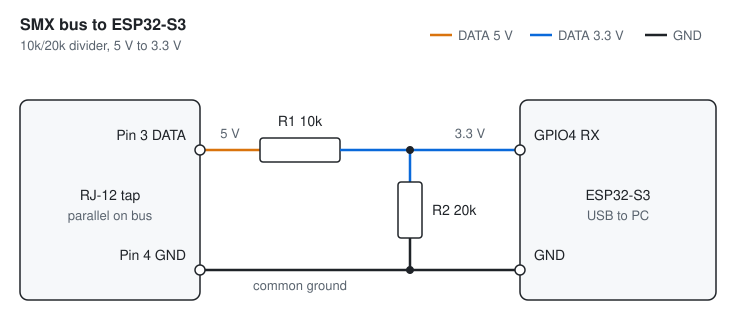

# esp32-smxlights

ESP32-S3 firmware that listens to the StepManiaX panel data bus and logs it.

Step 1 (firmware): receive the bus (UART 250 kbaud 8N1, read-only, frames separated by
idle gaps at ~60 Hz) and hex-dump each frame to the USB serial console.
Step 2 (`smx_bus.py`, `smx_lights_player.py`): decode the lights and play them back.

## Wiring

The SMX bus uses RJ-12 jacks (J2 OUT / J3 IN): **pin 3 = DATA (5 V), pin 4 = GND**.
It's a single unterminated, unbiased 5 V net. The ESP32-S3 is **not 5 V tolerant**,
so you have to drop the level before it reaches the pin. Tap the bus in parallel (splitter /
pass-through, straight-through cables); don't put the ESP in series.

Default: resistor divider (5 V -> ~3.3 V, ~30 kOhm load on the bus):



```
RJ-12 pin 3 (DATA) ──[10k]──┬── GPIO4 (UART1 RX)
                            │
                          [20k]
                            │
RJ-12 pin 4 (GND)  ─────────┴── ESP32 GND
```

Sturdier alternative: a 74LVC1G17 / 74LVC1G125 buffer powered at 3.3 V (5 V-tolerant
input), with a 1k-4.7k series resistor on its input.

Don't use BSS138 bidirectional shifter boards: they add a 10k pull-up to 5 V onto the bus.

GPIO4 is used because this board only breaks out GPIO1-13. Any of 1, 2, 4-13 works (set
`SMX_RX_PIN`). Avoid GPIO0/3/45/46 (strapping), 19/20 (USB), 43/44 (UART0 console),
26-37 (flash/PSRAM).

## Build / flash / monitor

All tooling lives inside the repo (`.venv/`, `.pio-core/`):

```sh
python3 -m venv .venv && .venv/bin/pip install platformio   # first time only
source env.sh
pio run                 # build
pio run -t upload       # flash
pio device monitor      # view log
```

By default the log goes out the S3's native **USB** port. To use the **UART** (USB-serial
bridge) connector instead, set `ARDUINO_USB_CDC_ON_BOOT=0` and `ARDUINO_USB_MODE=0` in
`platformio.ini`.

## Options (`platformio.ini` build_flags)

| Flag | Default | Meaning |
| --- | --- | --- |
| `SMX_RX_PIN` | 4 | GPIO for the DATA line |
| `SMX_RX_INVERT` | 0 | Invert RX (use it if you see only frame errors) |
| `SMX_STRIP_BREAK_NULL` | 0 | Drop the trailing `0x00` the BREAK leaves in the FIFO |
| `SMX_OUTPUT_BINARY` | 0 | 1 = compact binary packets (about 3.5x less USB traffic) for the `web/` overlay bridge. The Python tools only read the default text format |

## Output

```
#123 t=+33.3ms len=N
  0000: aa bb cc ...
[stats] fps=30 len=N..N dropped=0 trunc=0 fifo_ovf=0 frame_err=0 parity_err=0
```

- `t=+` is the time since the previous frame.
- Frames end on a UART BREAK *or* on >4 ms of idle line. On the real bus no BREAK
  was detected; frames are separated by idle gaps instead (~60 frames/s).

## Decoding / playback

The bus carries the SDK's lights commands (see `smx_bus.py` for details):
`'2'` + 216 bytes (top 8 LEDs of each of 9 panels, RGB) and `'3'` + 216 bytes
(bottom 8), alternating at 60 Hz, giving 30 full frames/s. Colours are pre-scaled
by 2/3 by the SDK. There's also an occasional `'w'` + 130-byte config packet.

```sh
.venv/bin/pip install numpy pillow pygame-ce pyserial
python3 smx_bus.py captures/raw2.txt                       # decode summary
python3 smx_lights_player.py --serial /dev/cu.usbmodem14301 --record cap.txt   # live
python3 smx_lights_player.py --bus-log cap.txt --loop      # replay a recording
```

Close any `pio device monitor` first; only one program can hold the port.

## Twitch / OBS overlay (`web/`)

A small Node.js bridge reads the ESP32, decodes the lights, and serves a canvas overlay
over HTTP + WebSocket. Add it to OBS / Streamlabs / Twitch Studio as a **Browser Source**.
It works the same on Windows, macOS and Linux.

**Run it**, either way:

- Download `smx-overlay-<os>-<arch>` from the GitHub Releases page and run it (double-click,
  or from a terminal).
- From source (Node 18+): `cd web && npm install && npm start`

It picks the ESP32 automatically (Espressif USB VID `303A`, then CH340/CP210x/FTDI, then the
only USB serial port). To choose one yourself: `--serial COM3`, `--serial /dev/ttyACM0`, or
`--serial /dev/cu.usbmodem14301`. `--list` shows the ports.

**In OBS**: Sources > + > Browser, URL `http://localhost:8080/?transparent=1`, width/height
600 x 600 (any square works; the stage scales to fit).

| URL option | Meaning |
| --- | --- |
| `transparent=1` | no background (for overlays) |
| `boards=0` | hide the panel boards, LEDs only |
| `bloom=0` | turn off the glow |
| `hud=1` | show port / fps / status text (good for a quick check in a normal browser) |
| `gap=8` | space between panels (default 8; `gap=0` makes the boards touch) |
| `ws=host:port` | bridge address, if the page is served from somewhere else |

Other bridge options: `--log cap.txt --loop` replays a recording (`npm run demo` replays
`captures/raw2.txt`). `--record file.txt` saves the bus in the text log format, which
`smx_lights_player.py --bus-log` can read. `--port 8081` changes the HTTP port, and
`--host 0.0.0.0` makes it reachable from a second streaming PC. The bridge reconnects if the
ESP32 is unplugged, and the overlay reconnects if the bridge restarts.

The bridge reads both firmware formats. For the lowest USB load, build the firmware with
`-DSMX_OUTPUT_BINARY=1`, but then `pio device monitor` and `smx_bus.py` show binary noise
until you switch back.

**First launch of the downloaded executables** (they aren't code-signed):

- macOS: right-click > Open once, or `xattr -d com.apple.quarantine smx-overlay-macos-*`.
- Windows: SmartScreen > More info > Run anyway.
- Linux: `chmod +x`. Your user needs the `dialout` group (Debian/Ubuntu/Fedora) or `uucp`
  (Arch/Manjaro) to open the port: `sudo usermod -aG uucp $USER`, then log out and back in.

**Build the executables yourself**: `cd web && npm run build` (this OS) or
`npm run build:win | build:mac | build:linux`; the output goes to `web/dist/`. macOS builds
made on another OS must be signed on a Mac before they run (`codesign --sign - <file>`).
`.github/workflows/overlay-release.yml` builds and smoke-tests all four targets on their own
runners. Pushing a `v*` tag attaches the zipped executables to a GitHub Release.
- With the cable unplugged, the divider holds RX low. The UART sees that as a continuous BREAK,
  so expect break/frame-error noise in that case.
